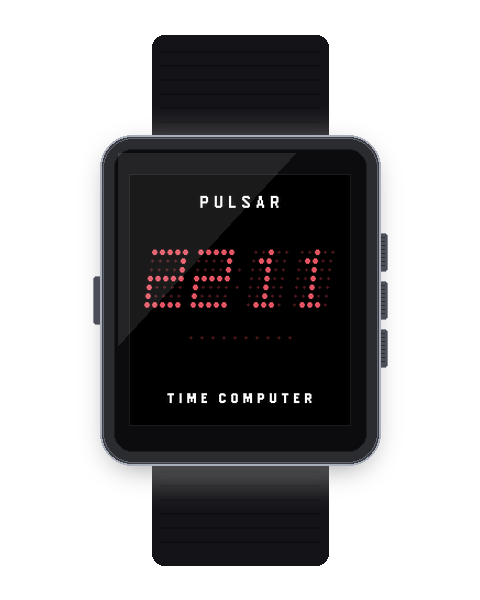
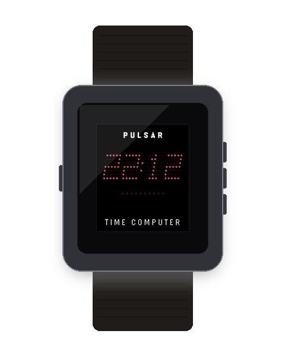

# Pulsar 1970 Watchface `v3.0.0`

<p align="center">
  
  
</p>

An authentic procedural LED digital watchface for Pebble OS recreating the legendary 1970 Hamilton Pulsar Time Computer.

---

## ⚡ Features

- **Procedural 5x7 GaAsP Dot-Matrix Font:** Authentic micro-LED rendering with procedural glow halos and zero bitmap bloat.
- **Dynamic Battery Saver Engine:** Automatic tick throttling from 1 Hz down to 1/min when the colon is static, in stealth sleep, or during overnight sleep, eliminating +241 µA battery penalty.
- **Two-Step Flick & Tap Navigation:** First flick from dark illuminates the backlight and stays on the Time screen; subsequent flicks or taps during the interaction window cycle through secondary screens.
- **PebbleOS 4.41+ Palm-to-Sleep:** Covering the display with your palm immediately turns off the backlight and returns to Time.
- **6 Configurable Operating Modes:** Time (`HH:MM`), Live Seconds (`:SS`), Calendar Date (`MM.DD`), Step Count (`STEPS`), Battery Percentage (`BATT`), and Heart Rate (`BPM`).
- **Micro-LED Bead Gauge:** Ten-dot progress bar tracking daily step goal progress or battery level with charging animations (Flow, Cylon chaser, Marquee, Heartbeat pulse).
- **8-Bit Retro Synth Audio:** Hourly tone chimes and step celebration fanfares on speaker-equipped hardware, fully compliant with system Quiet Time and muted speaker states.
- **7 Vintage Colorways:** GaAsP Ruby Red, Hot Lava Orange, GaP Phosphor Green, Amber Gold, Electric Cyan, Lunar White, and Inverted High-Contrast Paper.
- **Matched Backlight Tinting:** Optionally tint your watch's backlight to match the active LED colour on supported hardware.

---

## ⚙️ Clay Configuration Keys

| Key | Description | Type | Default |
| :--- | :--- | :--- | :--- |
| `AppKeyColorway` | LED color palette (Ruby, Lava, Green, Amber, Cyan, White, Paper) | select | Ruby Red (`0`) |
| `AppKeyLedGlow` | Optical bloom halo around lit dots | toggle | Enabled (`true`) |
| `AppKeyShowGhost` | Display unlit dots of the matrix | toggle | Disabled (`false`) |
| `AppKeyBacklightTint` | Match backlight color to active LED colorway | toggle | Disabled (`false`) |
| `AppKeyItalicSlant` | Vintage rightward matrix slant | toggle | Enabled (`true`) |
| `AppKeyHeaderStyle` | Header branding (PULSAR, HAMILTON, SOLID STATE, None) | select | PULSAR (`0`) |
| `AppKeyFooterStyle` | Footer branding (TIME COMPUTER, SOLID STATE, HAMILTON, etc.) | select | TIME COMPUTER (`0`) |
| `AppKeyOperatingMode` | Always-On vs Stealth (wake on flick/tap) | radiogroup | Always-On (`0`) |
| `AppKeyNightlight` | Keep display active while charging on dock | toggle | Disabled (`false`) |
| `AppKeyDateFormat` | Date layout (MM DD vs DD MM) | select | MM DD (`0`) |
| `AppKeyLeadingZero` | Leading zero on hours | toggle | Disabled (`false`) |
| `AppKeyBlinkColon` | 1 Hz blinking colon separator (turn off to save battery) | toggle | Enabled (`true`) |
| `AppKeyBeadMode` | Micro-LED bar mode (Steps, Battery, Off) | select | Steps (`0`) |
| `AppKeyStepGoal` | Daily Pebble Health step target | select | `10000` |
| `AppKeyChargingStyle` | Animation style while charging (Flow, Chaser, Pulse, Marquee, Solid, Off) | select | Flow (`0`) |
| `AppKeyCycleSlot1–5` | Screen cycle sequence for taps/flicks | select | Sec, Date, Steps, Batt, Off |
| `AppKeySoundEnabled` | Master audio gate for speaker sounds | toggle | Enabled (`true`) |
| `AppKeyHourlyBeep` | Hourly audio chime (respects Quiet Time) | toggle | Disabled (`false`) |
| `AppKeyHourlyVibe` | Hourly vibration pulse (Off, Single, Double) | select | Off (`0`) |
| `AppKeyStepCelebration` | Step goal celebration (Off, Vibe, Chime, Both) | select | Vibe (`1`) |

---

## 📦 Building & Asset Commands

```bash
# Build app PBW bundle
npm run build:watchface

# Capture and validate screenshots + generate 3D hardware mockups
npm run assets:watchface
```
